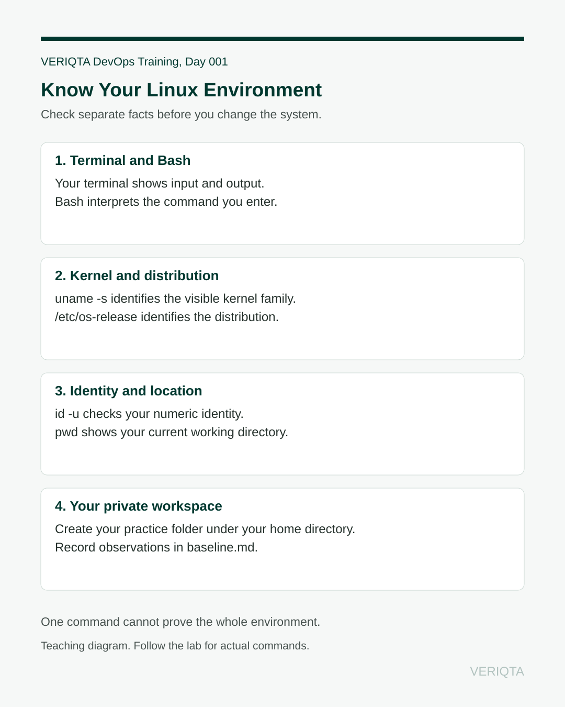

# Day 001, Your Linux Environment and First System Baseline

You have been asked to prepare a Linux lab for a small application. Before installing software or changing configuration, you need to identify the environment and record what you actually observed.

Today's outcome: create a private workspace and a readable baseline file describing your Linux environment, then prove that the file still exists after you leave and return.

## Before you begin

- Read [Start here](../../../../START-HERE.md) and the [environment guide](../../../../docs/environment.md).
- Use an authorized Linux environment with Bash, common utilities, and vi.
- Use a regular user. Pause if the numeric user ID is zero.
- Allow around 45 to 60 minutes, including explanation and your assessment. Setup is separate.

You need no cloud account, paid service, package installation, or administrator command. You do not deploy the application today.

## The engineering idea

Imagine taking over a restaurant kitchen. Before changing equipment, you check which kitchen you are in, what equipment is present, and which workbench you are allowed to use. Otherwise, even a sensible instruction might be applied in the wrong place.

Your Linux distribution is part of the operating environment. Your user identity determines permissions. Your current directory determines where relative paths point. Your lab directory is your workbench. Your baseline is the dated record of what you found.

The analogy helps you remember to inspect first. A real system is more complex: a container can share a kernel with its host while presenting a different filesystem. No single command proves the full deployment architecture.

Text equivalent: you type into a terminal, Bash interprets your command, and the command asks the operating system for information. Check kernel, distribution, identity, and location separately. Keep the resulting baseline in a private practice directory.

## Follow the lesson

1. Read the [notes and command explanations](notes.md).
2. Complete the [guided lab](lab.md), one command at a time.
3. Apply the result to your [evolving project](project.md).
4. Answer the [knowledge checks](knowledge-checks.md).
5. Complete the [independent assessment](assessment.md).
6. Retain the items in the [evidence checklist](evidence/README.md).

If a command fails or output differs, use [troubleshooting](troubleshooting.md).

## Completion criteria

You can distinguish the kernel from the distribution, identify your current user and numeric ID, explain an absolute path, locate your private workspace, read your saved baseline, and reopen it after leaving the directory. Your assessment includes one evidence-based explanation of the environment's limits.

Material status: published. Author checks and platform limitations are recorded in the [lesson index](../../../../PROGRESS.md). Your completion depends on your own verified results.

This is the first lesson, so there is no previous day. Day 002 is planned and has no published link yet.

[Week 01](../README.md) · [Linux module](../../README.md) · [Lesson index](../../../../PROGRESS.md)
